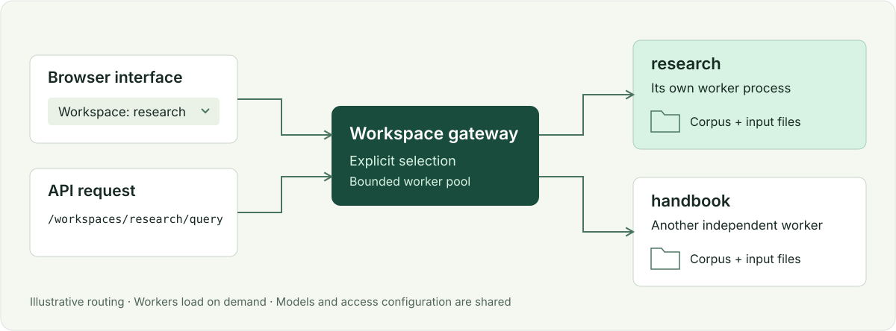

# LightRAG Workspaces

**Отдельные базы знаний в одном интерфейсе и API.**

Независимое расширение [HKUDS/LightRAG](https://github.com/HKUDS/LightRAG): переключатель workspace в браузере и выбор базы в каждом API-запросе. Данные хранятся в файлах или **PostgreSQL с VectorChord**. Каждая активная база работает в собственном процессе.

[English](README.md) · [Документация](https://forcewake.github.io/lightrag-workspaces/) · [Быстрый старт](docs/getting-started/quickstart.ru.md) · [Перенос существующих данных](docs/guides/existing-data.md)



*На схеме используются вымышленные названия баз. Это расширение сообщества, а не официальный релиз LightRAG.*

## Установка

Нужны Docker с Compose, память для ваших баз и доступные LLM/embedding-провайдеры. Сборка скачивает закреплённые исходники и образы.

```sh
git clone https://github.com/forcewake/lightrag-workspaces.git
cd lightrag-workspaces
cp .env.example .env
```

Укажите в `.env` адреса провайдеров, ключи, модели и размерность embeddings. Для существующих индексов нужно сохранить прежнюю embedding-модель и размерность.

```sh
docker compose build
docker compose run --rm --no-deps --entrypoint python lightrag /opt/lightrag-multiworkspace/scripts/init_workspace.py default
docker compose up -d
```

Откройте **[localhost:9621/webui/](http://localhost:9621/webui/)**. Чтобы добавить пустую базу:

```sh
docker compose run --rm --no-deps --entrypoint python lightrag /opt/lightrag-multiworkspace/scripts/init_workspace.py research
```

Обновите страницу и выберите `research` сверху. Диалоги и параметры браузера сохраняются отдельно для каждой базы. Неизвестный workspace в API вернёт `404`; случайно создать базу запросом нельзя.

## API

Выбор через адрес:

```sh
curl http://localhost:9621/workspaces/research/query \
  -H 'Content-Type: application/json' \
  -d '{"query":"Что сказано в документах?","mode":"mix"}'
```

Или через заголовок:

```sh
curl http://localhost:9621/query \
  -H 'Content-Type: application/json' \
  -H 'LIGHTRAG-WORKSPACE: research' \
  -d '{"query":"Что сказано в документах?","mode":"mix"}'
```

Без выбора используется `LIGHTRAG_DEFAULT_WORKSPACE` — в примере это `default`. При включённой аутентификации добавьте `X-API-Key` или bearer-токен. Swagger выбранной базы: `/workspaces/research/docs`. [Потоковые ответы и загрузка файлов](docs/guides/api.md).

## Если данные уже есть

**Сначала остановите старый сервис и сделайте проверенную резервную копию.** Испытайте расширение на независимой копии данных. Два сервиса не должны одновременно писать в один индекс.

Расширение сохраняет точные имена workspace и не запускает скрытую миграцию. Если в базе осталась незавершённая очередь импорта, изменения блокируются, а совместимый поиск остаётся доступен. Старые ошибки не исправляются автоматически. Запросы, загрузка и удаление после запуска могут штатно менять кеш и индекс.

Поддерживается перенос JSON, NanoVectorDB и GraphML в **PostgreSQL + VCHORDRQ**: документы, статусы, чанки, векторы, граф и кеш. Для переноса используется новая отдельная база и новый каталог управляющих файлов. Оригиналы и резервная копия сохраняются. Переключение в UI, адреса `/workspaces/<id>/…` и заголовок `LIGHTRAG-WORKSPACE` работают с прежними именами. [Инструкция на русском](docs/guides/postgresql.ru.md).

[Перенос данных](docs/guides/existing-data.md) · [Unraid](docs/guides/unraid.md) · [Резервное копирование и откат](docs/guides/backup-and-rollback.md)

С **0.2.2** native-парсер Markdown включает заголовки колонок в текст до построения chunks и embeddings. Это действует для новых разборов; уже созданные индексы обновляются отдельной операцией с резервной копией. Подробности — в [руководстве по обработке файлов](docs/guides/file-processing.md#search-table-column-labels).

## Ограничения

- Закреплён **LightRAG 1.5.7**. Обновлять upstream нужно после проверки совместимости.
- Файловый режим: `JsonKVStorage`, `JsonDocStatusStorage`, `NanoVectorDBStorage`, `NetworkXStorage`.
- PostgreSQL: `PGKVStorage`, `PGDocStatusStorage`, `PGVectorStorage` с `VCHORDRQ`, `PGTableGraphStorage`. Векторы сохраняются как `vector`, с исходной точностью float32; качество приближённого поиска проверяется отдельно.
- Модели и ключи провайдеров общие для всех workspace.
- Workspace не заменяет разграничение доступа между пользователями. Это разделение данных и процессов, а не защита разных арендаторов.
- Compose по умолчанию слушает только `127.0.0.1`. Публичный доступ требует отдельной настройки аутентификации и защищённого входа.
- Большая база открывается дольше и требует памяти. Если все процессы заняты или памяти мало, API возвращает `503`; повторите запрос после завершения текущей работы.

## Разработка и лицензия

[Разработка](docs/development.md), [правила участия](CONTRIBUTING.md), [архитектура](docs/reference/architecture.md), [безопасность](SECURITY.md).

MIT. Основано на работе авторов [HKUDS/LightRAG](https://github.com/HKUDS/LightRAG); атрибуция — в [THIRD_PARTY_NOTICES.md](THIRD_PARTY_NOTICES.md). Проект не заявляет официального одобрения upstream.

## Каталог и обслуживание в 0.3

В обеих версиях интерфейса доступны поиск workspace по ID, названию, описанию и тегам, избранное в браузере и состояния запуска. Создавайте пустой workspace через **New workspace** или `POST /workspaces` с `Idempotency-Key`. При потерянном ответе повторяется тот же запрос с тем же ключом; существующий корпус не перезаписывается. Изменение отображаемого названия не меняет ID, namespace в PostgreSQL, URL/API и историю браузера.

`/livez` проверяет процесс, `/readyz` — готовность базы и регистраций без запуска worker. Состояние выбранного workspace доступно через `/workspaces/<id>/status`.

[Инструменты обслуживания](docs/guides/operations.md) создают согласованный backup PostgreSQL, исходных файлов и регистраций, проверяют архив и восстановление в отдельной базе, сохраняют предыдущий контейнер для отката приложения. Откат приложения не откатывает базу. Ротация затрагивает только собственные архивы инструмента и сохраняет точки, нужные для восстановления. Копирование на второе хранилище включается отдельно.

[Проверки качества](docs/guides/quality.md) после загрузки и обновления требуют заданные факты из указанных источников с корректными ссылками. `processed` означает завершение обработки; успешный поиск подтверждается отдельно. Примеры содержат только вымышленные данные, отчёты реальных проверок остаются приватными.
